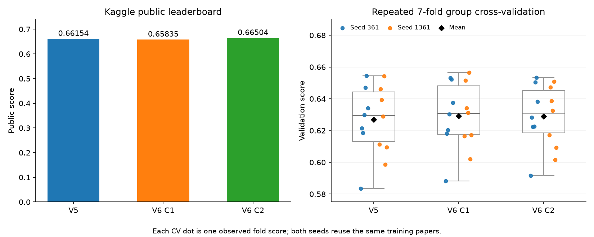
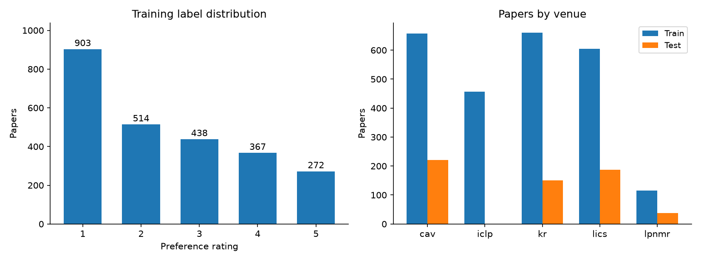

<div align="center">

# Research Paper Recommendation

### Learning a reading order from paper titles and metadata

[](#setup)
[](#model)
[](#model)
[](#reproducibility)
[](#results)

*CO3029 Data Mining · HCMUT · Team DMM*

</div>

This is our solution to the [Assignment Data Mining - 261](https://www.kaggle.com/competitions/assignment-data-mining-261/overview) competition. Given papers rated by a reader, we train models to select new papers worth reading and rank them by preference. The experiments compare TF-IDF baselines with SVC and ordinal classifiers on frozen E5/BGE embeddings.

The best submission, **V6 candidate 2**, scored **0.66504** on the Public leaderboard. The code includes data checks, experiment scripts, and a separate command to reproduce that submission from the original files.

## Project information

| Item | Details |
|---|---|
| Course | CO3029 — Data Mining |
| Institution | Ho Chi Minh City University of Technology, VNU-HCM |
| Team | DMM |
| Data | 2,494 training papers and 596 test papers |
| Output | CSV with `id` and `priority` |
| Reference environment | Windows x64, Python 3.12.10, CPU |

## Results

The latest three submissions were compared using the same two 7-fold CV splits:

| Submission | Mean CV | Public score |
|---|---:|---:|
| V5 candidate 1 | 0.626918 | 0.66154 |
| V6 candidate 1 | **0.629241** | 0.65835 |
| V6 candidate 2 | 0.628887 | **0.66504** |

<p align="center">
  
</p>

The left panel shows the reported Public scores. In the right panel, each dot is an observed fold score; diamonds mark the means. The two CV seeds reuse the same papers. Candidate 1 had the higher mean CV score, while candidate 2 performed better on Public. Private scores are not available yet.

### Submission history

| Submission | Main change | Public score |
|---|---|---:|
| V1 candidate 1 | Logistic Regression with TF-IDF and metadata | 0.61105 |
| V1 candidate 2 | Ridge Regression | 0.60591 |
| V2 candidate 1 | Title-only ordinal Logistic Regression | 0.62516 |
| V2 candidate 2 | Ordinal model with metadata | 0.61864 |
| V3 candidate 1 | E5-small ordinal + TF-IDF ordinal | 0.63502 |
| V4 candidate 1 | BGE-base SVC ensemble | 0.66016 |
| V5 candidate 1 | E5-base SVC and ensemble refinement | 0.66154 |
| V6 candidate 1 | E5-base metadata branch | 0.65835 |
| **V6 candidate 2** | **BGE with author and venue features** | **0.66504** |

These are the scores recorded through **27 October 2026**. Experiment notes are in [EXPERIMENT_LOG.md](docs/EXPERIMENT_LOG.md). The selected configuration and reference hashes are in [REFERENCE_V6.json](docs/REFERENCE_V6.json).

## Data

Each paper has `id`, `title`, `venue`, `year`, `authors`, and `doi`. Training labels range from 1 to 5: a rating of 1 means the reader does not want to read the paper, while higher ratings indicate more interest.

<p align="center">
  
</p>

Rating 1 accounts for 903 of the 2,494 training papers. The training set includes 456 ICLP papers, but test has no ICLP papers. We keep them for model fitting and report the main validation metric on the venues present in test.

The figures are generated with Matplotlib from [results/figure_data.json](results/figure_data.json). That file contains aggregate counts, recorded Public scores, and the actual CV fold scores. It also records the source report's SHA-256. Plotting code is in [tools/make_readme_figures.py](tools/make_readme_figures.py).

## Pipeline


## Model

V6 candidate 2 averages four prediction branches:

| Component | Description | Weight |
|---|---|---:|
| `bge_authors75` | BGE-base SVC with author, venue, and numeric features | 0.25000 |
| `bge_svc_c4` | BGE-base SVC | 0.28125 |
| `e5base_c4_g2` | E5-base SVC with gamma factor 2 | 0.18750 |
| `old_v3` | Equal blend of TF-IDF ordinal and E5-small ordinal with metadata | 0.28125 |

Each branch predicts expected gain, `E[(Label - 1) / 4]`, and reading probability, `P(Label > 1)`. All SVC branches use `C=4`. The ordinal branches fit four binary classifiers for `Label > 1`, `> 2`, `> 3`, and `> 4`; their mean probability estimates gain. Classifier seeds are fixed at **261**.

### Features

- Titles: word/character TF-IDF and frozen semantic embeddings.
- Venue: one-hot encoding.
- Authors: TF-IDF over individual names, with a minimum frequency of two in the training portion.
- Numeric metadata: publication year, missing year, title length, and author availability.

In the metadata SVC branch, author, venue, and numeric features are scaled by 0.75, 0.35, and 0.05. `id` is used for row matching and tie-breaking; `doi` is used to group duplicates. Neither is a model feature.

| Encoder | ONNX format | Dimensions | Pooling |
|---|---|---:|---|
| [E5-small-v2](https://huggingface.co/intfloat/e5-small-v2) | INT8 | 384 | Mean |
| [E5-base-v2](https://huggingface.co/intfloat/e5-base-v2) | INT8 | 768 | Mean |
| [BGE-base-en-v1.5](https://huggingface.co/BAAI/bge-base-en-v1.5) | FP32 | 768 | CLS |

The encoders remain frozen. E5 uses the `query: ` prefix; BGE uses no prefix. Inputs are truncated at 128 tokens and pooled embeddings are L2-normalized. Pinned revisions and sources are listed in [THIRD_PARTY.md](docs/THIRD_PARTY.md) and the downloaded asset manifests.

### Selection policy

We select the top `ceil(0.60 * N)` papers by:

```text
utility = expected_gain + 0.5 * probability_read
```

The selected papers are ordered by expected gain. Positive priorities encode that order on `(0, 10]`; the rest receive 0. For the test set, this gives **358 recommendations** and **238 zeros**.

## Validation

V6 uses two runs of 7-fold `StratifiedGroupKFold`, with seeds **361** and **1361**. Papers linked by normalized titles or DOI/URL identifiers stay in the same fold. Vocabulary, IDF, centering, and metadata encoders are fitted on the training portion of each fold.

Models are fitted on all venues. The main validation score is calculated on `cav`, `kr`, `lics`, and `lpnmr`, matching the venues present in test.

| Model | Seed 361 | Seed 1361 | Mean |
|---|---:|---:|---:|
| V5 | 0.626976 | 0.626860 | 0.626918 |
| V6 candidate 1 | 0.628531 | 0.629952 | 0.629241 |
| V6 candidate 2 | 0.629567 | 0.628207 | 0.628887 |

Both seeds reuse the same papers, and earlier experiments had already used these labels. The results reflect repeated model selection on the same dataset. Earlier development/holdout results use a different protocol and should be read separately. The fold distributions in the figure are descriptive; they are not confidence intervals from independent datasets.

The local metric is the harmonic mean of position-weighted relevance and recall of papers rated above 1. Its implementation is in [`metric.py`](paper_priority/metric.py). [METRIC_AND_RULES.md](docs/METRIC_AND_RULES.md) records the difference between the original Overview summary and the detailed Evaluation description; the hidden scorer has not been inspected.

## Setup

The commands below reproduce V6 candidate 2 on Windows x64 with Python 3.12. Training and inference run on CPU. Docker and a GPU are not required.

Run from the repository root in PowerShell:

```powershell
py -3.12 -m venv .venv
.\.venv\Scripts\python.exe -m pip install -r requirements-semantic.txt
.\.venv\Scripts\python.exe -m pip check
```

`requirements-semantic.txt` includes the base requirements and pins the ONNX/tokenizer dependencies. If `py` is unavailable, use `python -m venv .venv` with Windows x64 Python 3.12. Activation is optional because the commands use the interpreter inside `.venv` directly.

### Download the data

Download the files from the competition's [Data page](https://www.kaggle.com/competitions/assignment-data-mining-261/data) and place them in:

```text
assignment-data-mining-261/
├── train.csv
├── Test.csv
└── Submission.csv
```

Keep the downloads unchanged. `Test.csv` contains RTF text despite its extension; the loader reads it through `striprtf`. Resaving it in a spreadsheet editor changes its reference hash.

```powershell
.\.venv\Scripts\python.exe -X utf8 main.py audit `
  --data-dir .\assignment-data-mining-261 `
  --out .\outputs\audit01
```

The report and cleaned copies are written under `outputs/audit01/`. Use `--data-dir` if the originals are stored elsewhere.

### Train the reference model

```powershell
.\.venv\Scripts\python.exe -X utf8 reproduce.py prepare

.\.venv\Scripts\python.exe -X utf8 reproduce.py train `
  --data-dir .\assignment-data-mining-261 `
  --out .\outputs\reproduce_v6 `
  --verify-reference
```

`prepare` downloads the three pinned ONNX encoders to `assets/encoders/` and checks their hashes. `train` fits the selected configuration on all training papers. Previous experiment outputs and classifier bundles are not required.

Internet access is needed to install dependencies and download encoders. Later runs can use the prepared assets offline. Embeddings are cached in `.cache/embeddings/`. Use a new output directory for each training run.

```text
outputs/reproduce_v6/
├── submissions/v6_candidate_2.csv
├── models/v6_candidate_2.joblib
├── predictions/v6_candidate_2_test.csv
├── reports/config.json
├── reports/reproduction.json
└── manifest.json
```

### Check the submission

```powershell
.\.venv\Scripts\python.exe -X utf8 main.py check `
  --data-dir .\assignment-data-mining-261 `
  --submission .\outputs\reproduce_v6\submissions\v6_candidate_2.csv
```

The CSV should contain 596 valid IDs, with 358 positive priorities. `--verify-reference` checks the input hashes and the final CSV hash; a successful run records `reference_match: true` in `reports/reproduction.json`.

Expected CSV SHA-256:

```text
31e9d52b555354168da504597eb671f97dee775533f2d09ae76d48c8f6e498aa
```

Upload the CSV through Kaggle. The scripts create local files only.

## Reproducibility

To predict from the model produced during training:

```powershell
.\.venv\Scripts\python.exe -X utf8 reproduce.py predict `
  --data-dir .\assignment-data-mining-261 `
  --bundle .\outputs\reproduce_v6\models\v6_candidate_2.joblib `
  --output .\outputs\verify_v6\from_bundle.csv
```

Add `--refit` to train the classifier heads again before predicting. It reuses the fixed encoders and available embedding caches. Training from the original files, saved-model prediction, and independent classifier refitting have produced the same reference CSV on Windows with Python 3.12.10. Test embeddings were also checked against an independent encoding pass.

```powershell
.\.venv\Scripts\python.exe -m unittest discover -s tests -v
.\.venv\Scripts\python.exe -m pip check
```

The **30 tests** cover the metric, tie handling, RTF/Unicode, submission validation, duplicate grouping, training-only vocabularies, unseen authors and venues, and model serialization. Each run records dependency versions and input/code/output hashes in `manifest.json`. `RELEASE_FILES.sha256` lists source and documentation checksums. Exact CSV agreement on other platforms has not been checked.

### Regenerate the figures

Plotting is optional and uses a separate dependency file:

```powershell
.\.venv\Scripts\python.exe -m pip install -r requirements-figures.txt
.\.venv\Scripts\python.exe tools/make_readme_figures.py
```

This reads the recorded aggregates in `results/figure_data.json` and writes PNGs and a plotting manifest to `results/figures/`. It does not retrain models. The data snapshot includes all 42 fold scores shown in the comparison figure; the figure manifest records library versions and input/output hashes.

## Repository structure

```text
├── reproduce.py                 # Prepare, train, and reproduce the selected model
├── main.py                      # Baseline training, data audit, CSV validation
├── paper_priority/              # Data processing, features, models, metric, CV
├── tests/                       # Unit tests
├── tools/
│   └── make_readme_figures.py    # Matplotlib figures from recorded measurements
├── results/
│   ├── figure_data.json         # Aggregate counts, Public scores, CV fold scores
│   └── figures/                 # PNGs and plotting manifest
├── docs/                        # Reference configuration and experiment notes
├── requirements.txt
├── requirements-semantic.txt
└── requirements-figures.txt      # Optional plotting dependency
```

Raw data, downloaded encoders, caches, outputs, and model bundles are excluded by `.gitignore`. The small aggregate result files and figures are included so the README renders after cloning.

The other entry points (`improve.py`, `semantic.py`, `fusion.py`, `refine.py`, `upgrade.py`, and `metadata_refine.py`) retain the earlier model-search experiments and may require outputs from previous stages. `reproduce.py` fits the selected configuration directly. Use `--help` for script arguments.

## References

- [Competition overview and evaluation](https://www.kaggle.com/competitions/assignment-data-mining-261/overview)
- [E5-small-v2](https://huggingface.co/intfloat/e5-small-v2) and [E5-base-v2](https://huggingface.co/intfloat/e5-base-v2)
- [BGE-base-en-v1.5](https://huggingface.co/BAAI/bge-base-en-v1.5)
- [Library and model sources](docs/THIRD_PARTY.md)
- [Experiment log](docs/EXPERIMENT_LOG.md)

Most historical experiment notes are in Vietnamese.
